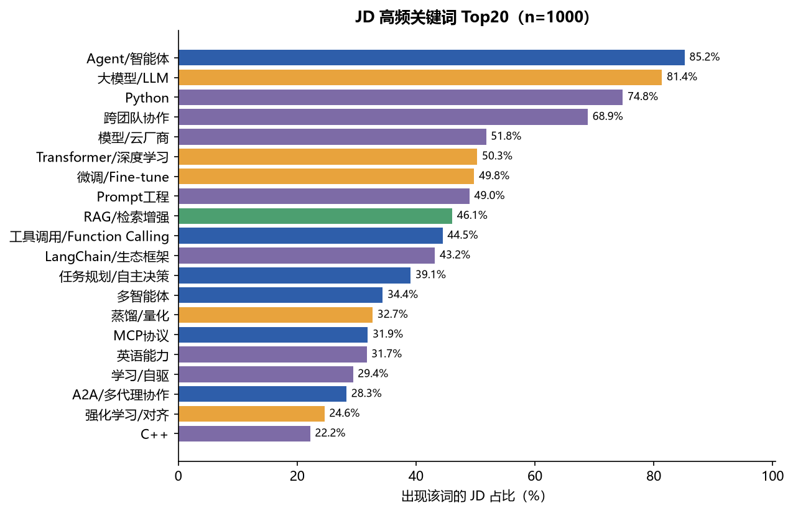
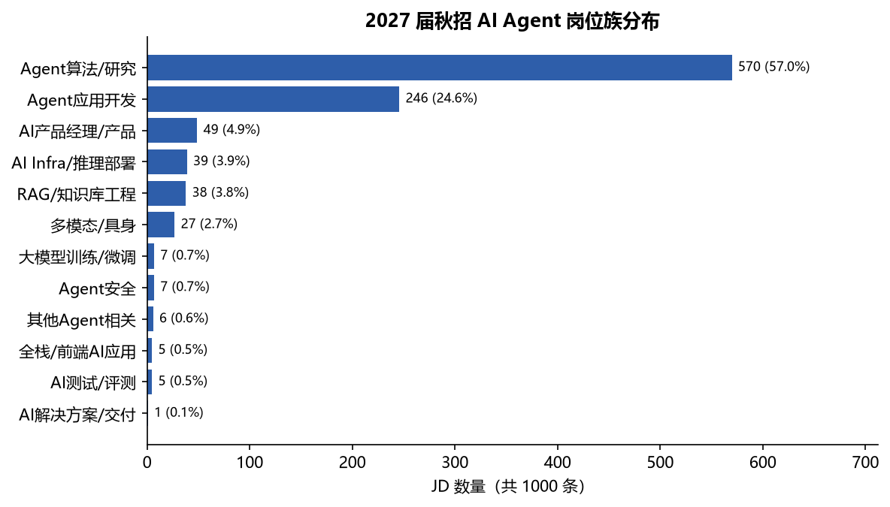
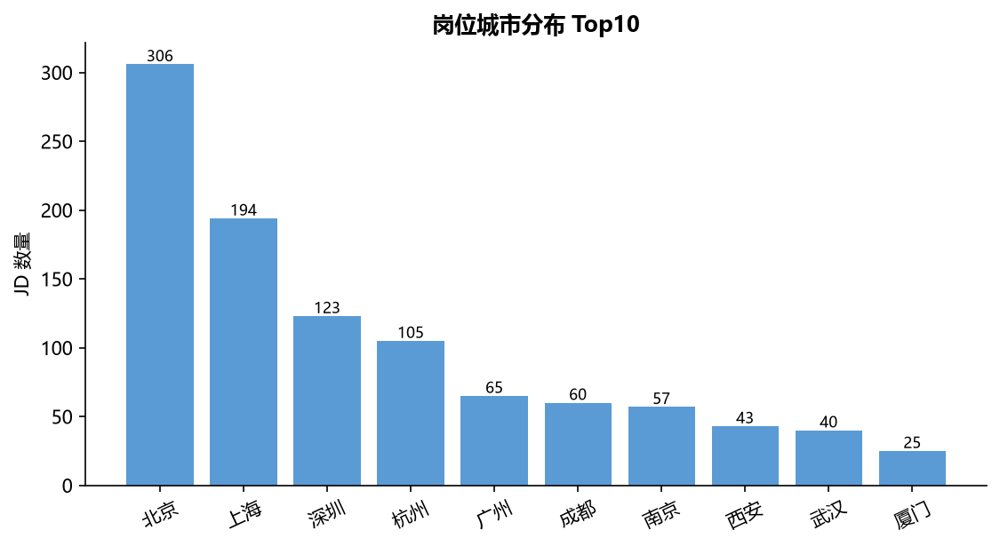
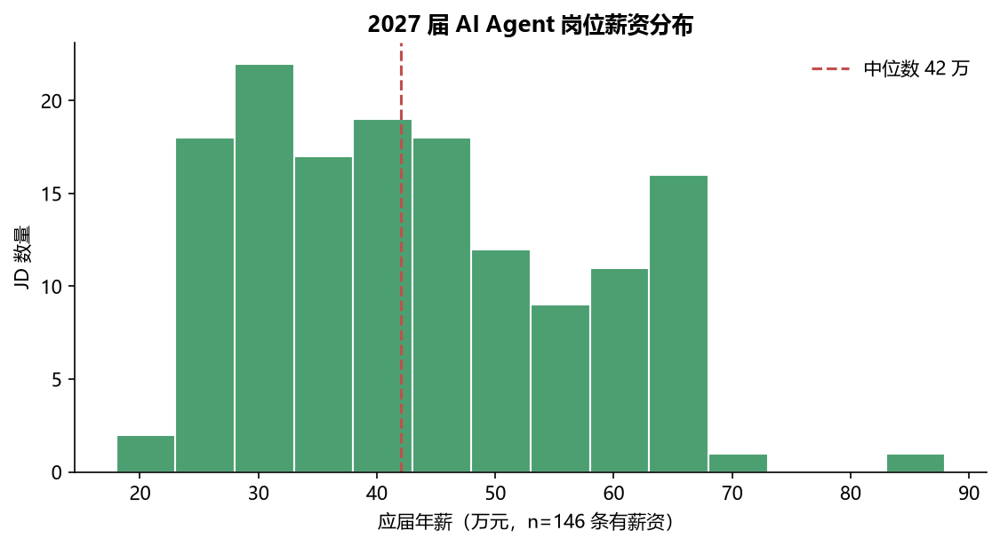
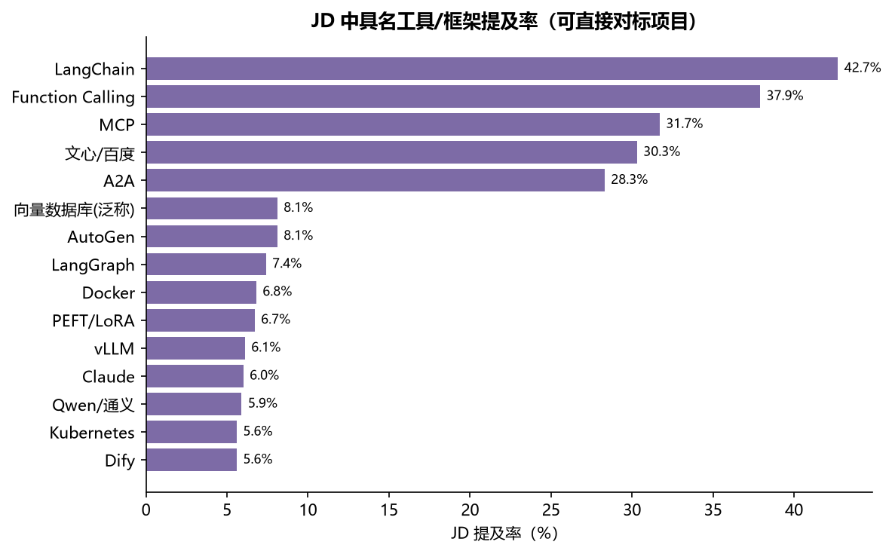
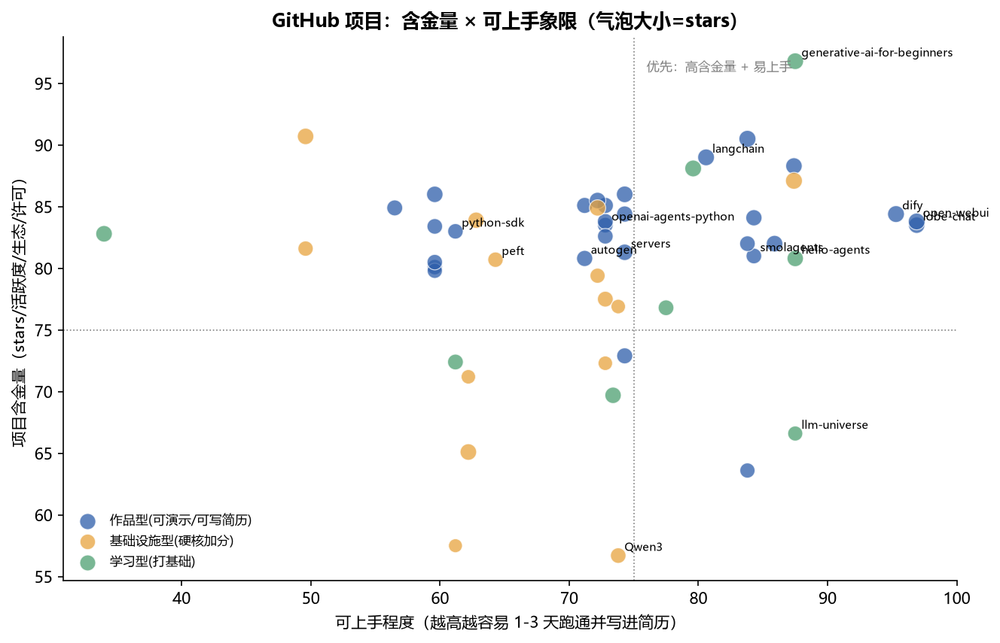

# 2027 届秋招 AI Agent 应用/开发 岗位情报与开源项目匹配报告

> 数据快照：2026-10-19 ｜ 样本：1,000 条 2027 届校招/实习在招 JD ｜ 覆盖 131 家公司 ｜ 项目库：75 个（GitHub API 实时校验）

## 一、核心结论（先看这一页）

- **Agent 已从「岗位标签」下沉为「岗位基础设施」**：85.2% 的 JD 提及 Agent/智能体，但只有 24.5% 把 Agent 写进岗位名。也就是说，「懂 Agent」不再是加分项，而是 AI 岗的默认门槛；真正的区分度在于「能否用 Agent 交付可量化结果」。
- **需求结构仍是「算法 + 工程」复合型**：Agent 算法/研究 57.0%、Agent 应用开发 24.6%、AI 产品 4.9%、AI Infra 3.9%、RAG/知识库 3.8%。纯「调 Prompt 搭 Demo」的岗位几乎不存在，JD 普遍要求同时具备大模型理解、工程实现与业务落地。
- **技能栈呈三层结构**：必备层（Agent/智能体 85.2%、大模型/LLM 81.4%、Python 74.8%、RAG 46.1%、工具调用 44.5%、LangChain 43.2%）；加分层（微调 49.8%、Prompt 49.0%、多智能体 34.4%、MCP 31.9%、A2A 28.3%）；差异化层（评测体系 12.7%、向量检索 10.3%、记忆管理 7.7%、GraphRAG/文档解析 3.8%、Agent 安全 0.8%、Computer Use 0.4%——出现率低、候选人更少，做出来辨识度最高）。
- **2026 年新增的两个高性价比信号：MCP 与 A2A**。31.9% 的 JD 直接提到 MCP、28.3% 提到 A2A，比 2025 年显著上升；这两个协议类能力学习成本低、面试辨识度高，是「低成本高回报」的差异化点。
- **薪资与城市**：有公开薪资的 146 条 JD 中，应届年薪中位数 **42.0 万**（25 分位 30.2 万 / 75 分位 56.0 万）；北京 30.6%、上海 19.4%、深圳 12.3%、杭州 10.5%，四城合计 72.8%。
- **项目匹配结论**：75 个候选项目中，S 级 1 个、A 级 3 个（langchain、dify、generative-ai-for-beginners、LLaMA-Factory）。最优策略不是「做最多项目」，而是 **「1 个可演示的核心作品 + 1 个协议/安全类加分项 + 1 个 Infra 硬核项」** 的三件套组合，详见第五章。

## 二、数据与方法

### 2.1 数据来源

本次采集全部来自公开可访问的招聘页面与公开接口，采用低频访问（单站 ≥1 秒/请求），不登录、不绕过验证码、不破解反爬。具体来源与条数：

| 来源渠道 | 入口 | 条数 | 说明 |
|---|---|---|---|
| 牛客网岗位搜索 | nowcoder.com（公开搜索接口） | 838 | 2027 届校招/实习主战场，含大量官方 HR 直发岗位 |
| 百度招聘官网 | talent.baidu.com（公开接口） | 157 | 校招/实习岗位，含完整职责与要求 |
| 美团招聘官网 | zhaopin.meituan.com（公开接口） | 5 | 含「2026年（2027届）秋季校招」项目的完整 JD |

**未纳入的渠道及原因**：Boss 直聘、LinkedIn、脉脉等需要登录态或存在强反爬/用户协议限制，按合规要求未做绕过；这会导致样本对「中小厂 + 社招混合岗」覆盖不足，但对「2027 届校招大厂/中厂」这一核心目标群体的覆盖是充分的。

### 2.2 采集与筛选漏斗

| 步骤 | 剩余 | 规则 |
|---|---|---|
| ① 原始抓取 | 4,569 条 | 牛客/百度/腾讯/美团 四源原始记录 |
| ② 跨源去重 | 4,356 条 | 去重键 = 公司 + 岗位名 + 城市；重复时优先保留校招岗 |
| ③ 相关性过滤 | 2,136 条 | 限技术/产品类岗位 + 至少 1 个 Agent 强信号（Agent/智能体/工具调用/MCP/RAG/LangChain 等） |
| ④ 分层抽样 | **1,000 条** | 优先 2027 届校招/实习；大厂公司配额上限（如百度 ≤160、华为 ≤90）防止单源垄断 |

### 2.3 口径与局限（务必阅读）

- **届别判定**：258 条由页面明示「2027届」；742 条为「2027届(推断)」——2026 年 10 月时点在招的校招/实习岗即面向 2027 届毕业生，这是合理推断而非页面直标，已在数据表中用「(推断)」标记区分。
- **关键词统计口径**：文档级命中（1 条 JD 命中同一词多次只计 1 次），同义词已归并（Agent / AI Agent / 智能体 → 「Agent/智能体」；RAG / 检索增强 → 「RAG/检索增强」）。因此「85.2%」的含义是「85.2% 的 JD 至少出现一次 Agent 相关表述」。
- **样本非全量**：1000 条是「可公开抓取 + AI Agent 相关」的子集，不代表整个秋招市场；趋势判断建议与本报告的分层结构配合使用，而非把百分比当作市场绝对值。
- **薪资口径**：仅 146 条 JD 公开薪资字段，按「月薪 K × 薪数」折算年薪；未公开薪资的岗位不参与统计，可能存在高薪岗位披露率偏低的偏差。
- **项目评分含人工判断**：「可上手程度」中的难度/上手小时数为人工评分，权重（含金量 32% / 说服力 32% / 可上手 18% / 匹配度 18%）可按需调整，评分方法完全公开，见第五章与 Excel 07 sheet。

## 三、高频关键词：招聘方到底在写什么

下表为 1000 条 JD 中归并后的高频关键词（已剔除仅用于描述招聘对象的元词）。「JD 占比」= 含该词的 JD 数 / 1000；「岗位名占比」= 该词出现在岗位标题中的比例，二者差距能看出哪些词是「真岗位标签」、哪些只是「简历关键词」。

| 关键词（归并后） | 类别 | JD 占比% | 岗位名占比% | 出现在任职要求% |
|---|---|---|---|---|
| Agent/智能体 | 智能体与编排 | 85.2 | 24.5 | 60.5 |
| 大模型/LLM | 大模型基础 | 81.4 | 27.8 | 56.3 |
| Python | 工程与语言 | 74.8 | 0.1 | 52.1 |
| 跨团队协作 | 素养与门槛 | 68.9 | 0.1 | 50.4 |
| 模型/云厂商 | 框架与生态 | 51.8 | 0.3 | 39.8 |
| Transformer/深度学习 | 大模型基础 | 50.3 | 0.0 | 39.2 |
| 微调/Fine-tune | 大模型训练 | 49.8 | 0.0 | 41.3 |
| Prompt工程 | 框架与生态 | 49.0 | 0.0 | 42.4 |
| RAG/检索增强 | 检索增强与知识库 | 46.1 | 0.0 | 39.0 |
| 工具调用/Function Calling | 智能体与编排 | 44.5 | 0.1 | 36.8 |
| LangChain/生态框架 | 框架与生态 | 43.2 | 0.0 | 37.5 |
| 任务规划/自主决策 | 智能体与编排 | 39.1 | 0.0 | 35.2 |
| 多智能体 | 智能体与编排 | 34.4 | 0.0 | 30.8 |
| 蒸馏/量化 | 大模型训练 | 32.7 | 0.0 | 30.9 |
| MCP协议 | 协议与生态 | 31.9 | 0.0 | 30.2 |
| 英语能力 | 素养与门槛 | 31.7 | 0.0 | 30.4 |
| 学习/自驱 | 素养与门槛 | 29.4 | 0.0 | 16.2 |
| A2A/多代理协作 | 智能体与编排 | 28.3 | 0.0 | 28.3 |
| 强化学习/对齐 | 大模型训练 | 24.6 | 1.5 | 14.3 |
| C++ | 工程与语言 | 22.2 | 0.0 | 9.3 |

### 3.1 三个反直觉发现

- **「Agent」是语境词，不是岗位名**：85.2% 的 JD 提到 Agent，但岗位名里只有 24.5%。说明大量岗位是「大模型算法工程师」「AI 应用开发」在 JD 里要求 Agent 能力——搜索岗位时不能只搜 Agent，要搜「大模型/AI 应用/算法/应用开发」。
- **Python 是绝对刚需，C++/Java 是第二语言**：Python 74.8%，C++ 22.2%，Java 21.4%。Agent 应用开发岗以 Python 为主；做 Infra/端侧/高性能推理才需要 C++。
- **软技能不是套话**：「跨团队协作」68.9%、「学习/自驱」29.4%。Agent 岗普遍处于探索期，JD 反复强调「能快速验证、能推动落地」——这类要求往往对应「有没有真实项目从 0 到 1」的面试追问。

## 四、岗位需求解析

### 4.1 岗位族结构：算法研究主导，应用开发次之

| 岗位族 | JD 数 | 占比% | 薪资中位(万) | 主要城市 |
|---|---|---|---|---|
| Agent算法/研究 | 570 | 57.0 | 56.2 | 北京:179 / 上海:106 / 深圳:67 / 杭州:57 / 广州:40 |
| Agent应用开发 | 246 | 24.6 | 39.0 | 北京:52 / 上海:50 / 杭州:34 / 深圳:26 / 广州:16 |
| AI产品经理/产品 | 49 | 4.9 | 28.6 | 北京:24 / 上海:8 / 深圳:7 / 成都:3 / 南京:2 |
| AI Infra/推理部署 | 39 | 3.9 | 36.0 | 北京:19 / 上海:11 / 深圳:7 / 杭州:5 / 南京:1 |
| RAG/知识库工程 | 38 | 3.8 | 30.0 | 上海:6 / 北京:6 / 广州:6 / 杭州:6 / 深圳:6 |
| 多模态/具身 | 27 | 2.7 | 50.6 | 北京:10 / 深圳:7 / 上海:5 / 南京:3 / 成都:2 |
| Agent安全 | 7 | 0.7 | nan | 北京:2 / 多伦多:1 / 东莞:1 / 南京:1 / 深圳:1 |
| 大模型训练/微调 | 7 | 0.7 | 33.0 | 上海:4 / 北京:2 / 杭州:1 |

### 4.2 各族需求要点（从 JD 原文归纳）

| 岗位族 | 核心需求 | JD 高频证据 |
|---|---|---|
| Agent 算法/研究（57.0%） | 大模型训练/微调、强化学习对齐、Agent 数据合成、评测体系、论文/顶会 | 高频词：微调、RLHF、GRPO、数据合成、Benchmark、顶会；典型岗名「AI Agent 大模型算法工程师」「Agentic 大模型数据合成」 |
| Agent 应用开发（24.6%） | LangChain/LangGraph 编排、工具调用、RAG、后端工程、业务落地 | 高频词：LangChain、Function Calling、工作流、Python/Java、接口设计；典型岗名「Agent 应用开发」「AI Agent 服务端研发」 |
| RAG/知识库（3.8%） | 文档解析、chunk 策略、Embedding/重排、向量库、GraphRAG | 高频词：RAG、向量数据库、Milvus/Faiss、召回、重排；常与「知识库构建与优化」绑定 |
| AI Infra/推理（3.9%） | vLLM/SGLang 部署、KV cache、吞吐/延迟优化、GPU/CUDA | 高频词：推理优化、vLLM、量化、K8s、分布式；偏「平台/工程」岗 |
| AI 产品（4.9%） | 场景定义、需求分析、指标设计、Agent 产品化 | 高频词：产品规划、用户研究、数据指标、落地；要求懂技术边界 |
| 多模态/具身（2.7%） | VLM、语音、视觉、机器人 | 高频词：多模态、ASR/TTS、具身智能、视频理解 |

### 4.3 硬门槛、软门槛与差异化能力

| 维度 | 数据 | 解读 |
|---|---|---|
| 学历/届别 | 本科 64.0%、硕士 9.1%、博士 0.7%、不限 9.9%、未明示 16.1%；81% JD 提及学历 | 本科是主流门槛，硕士在算法/研究岗更常见；博士集中在研究型岗位 |
| 语言/工程 | Python 74.8%、C++ 22.2%、Java 21.4%、后端/架构 20.4%、前端/全栈 13.7% | 应用开发岗几乎必考 Python + 一个后端栈；Infra 岗看 C++/CUDA |
| 英语/科研 | 英语 31.7%、论文/顶会 20.1%、竞赛/实习 21.9% | 顶会论文是算法研究岗的强区分项；竞赛/实习是应用开发岗的证据 |
| 城市 | 北京 30.6%、上海 19.4%、深圳 12.3%、杭州 10.5%、广州 6.5%、成都 6.0%、南京 5.7%、西安 4.3% | 四城占 72.8%；成都/南京/西安是性价比选择 |
| 薪资 | 中位 42.0 万（n=146），25 分位 30.2 万，75 分位 56.0 万 | 算法/研究岗中位 56.2 万，应用开发 39.0 万，产品 28.6 万 |

### 4.4 具名工具/框架：项目选题的「点名率」

JD 里被点名的工具/框架，是最直接的「学了就能写进简历」的信号。下表为 1000 条 JD 中的具名提及率（同一 JD 多次出现只计 1 次）：

| 工具/框架/模型 | 命中 JD 数 | JD 占比% |
|---|---|---|
| LangChain | 427 | 42.7 |
| Function Calling | 379 | 37.9 |
| MCP | 317 | 31.7 |
| 文心/百度 | 303 | 30.3 |
| A2A | 283 | 28.3 |
| AutoGen | 81 | 8.1 |
| 向量数据库(泛称) | 81 | 8.1 |
| LangGraph | 74 | 7.4 |
| Docker | 68 | 6.8 |
| PEFT/LoRA | 67 | 6.7 |
| vLLM | 61 | 6.1 |
| Claude | 60 | 6.0 |
| Qwen/通义 | 59 | 5.9 |
| Kubernetes | 56 | 5.6 |
| Dify | 56 | 5.6 |

- **LangChain（42.7%）是唯一「不学就会被默认不会」的框架**；Framework 之争（LangChain vs LlamaIndex）在 JD 层面已经收敛，LangChain 出现率是 LlamaIndex 的 12 倍。
- **Function Calling（37.9%）与 MCP（31.9%）是「协议层」信号**：这两个词出现率高说明招聘方要的是「能把模型接到真实系统」的人，而不是只会聊天的人。
- **Dify（5.6%）、RAGFlow、FastGPT 等低代码/可视化平台的提及率不高，但实操价值极高**：它们能让你在 1-3 天内产出可演示交付物，且面试官普遍认可「用过 Dify 做过企业知识库」的工程落地感。

## 五、GitHub 项目匹配：含金量 × 说服力 × 可上手

### 5.1 评分方法

75 个候选项目全部通过 GitHub API 实时校验（stars / forks / 最近提交 / license / archived 状态）。综合分 = 含金量 32% + 说服力 32% + 可上手 18% + 需求匹配 18%：

| 维度 | 口径 |
|---|---|
| 含金量（32%） | stars 量级、最近提交活跃度、fork/star 生态比、License 合规性、是否归档 |
| 说服力（32%） | 招聘方认可度（人工 1-5 分）+ 该项目的 JD 关键词覆盖率 + 项目具名工具在 JD 中的提及率 |
| 可上手（18%） | 难度 1-5 分、上手小时数、是否有中文文档、是否需要 GPU |
| 需求匹配（18%） | 项目覆盖的 JD 高频词在「目标岗位族」JD 中的平均占比（族内占比，而非全语料均值） |

### 5.2 优先项目 Top 15

| 排名 | 项目 | 类型 | Stars | 上手(h) | 难度 | 综合分 | 等级 |
|---|---|---|---|---|---|---|---|
| 1 | langchain-ai/langchain | 作品型(可演示/可写简历) | 148066 | 6 | 2 | 88.5 | S |
| 2 | langgenius/dify | 作品型(可演示/可写简历) | 158869 | 3 | 1 | 75.1 | A |
| 3 | microsoft/generative-ai-for-beginners | 学习型(打基础) | 121616 | 8 | 1 | 75.0 | A |
| 4 | hiyouga/LLaMA-Factory | 基础设施型(硬核加分) | 75581 | 5 | 2 | 73.9 | A |
| 5 | ollama/ollama | 基础设施型(硬核加分) | 183797 | 1 | 1 | 71.7 | B |
| 6 | vllm-project/vllm | 基础设施型(硬核加分) | 94118 | 6 | 3 | 70.7 | B |
| 7 | open-compass/opencompass | 基础设施型(硬核加分) | 7528 | 4 | 2 | 70.5 | B |
| 8 | huggingface/peft | 基础设施型(硬核加分) | 21807 | 3 | 2 | 70.5 | B |
| 9 | QwenLM/Qwen3 | 基础设施型(硬核加分) | 27677 | 4 | 2 | 70.0 | B |
| 10 | ggml-org/llama.cpp | 基础设施型(硬核加分) | 131676 | 5 | 3 | 69.9 | B |
| 11 | milvus-io/milvus | 作品型(可演示/可写简历) | 46427 | 6 | 3 | 69.7 | B |
| 12 | qdrant/qdrant | 作品型(可演示/可写简历) | 35135 | 4 | 2 | 69.3 | B |
| 13 | sgl-project/sglang | 基础设施型(硬核加分) | 37353 | 6 | 3 | 69.0 | B |
| 14 | NVIDIA/NeMo-Guardrails | 基础设施型(硬核加分) | 7326 | 4 | 2 | 68.8 | B |
| 15 | langfuse/langfuse | 基础设施型(硬核加分) | 36014 | 4 | 2 | 68.6 | B |

### 5.3 S/A 级项目详解（建议至少做一个）

#### S 级 ｜ langchain-ai/langchain（148,066 stars，6 小时上手）

- **为什么值得做**：Agent 应用事实标准框架，JD 中出现频率最高的生态词之一，面试官默认你懂。JD 关键词覆盖 69.8%，具名工具提及率 42.7%。
- **实操任务**：用 LCEL 搭「检索 + 工具调用 + 多轮记忆」客服 Agent，接入自建知识库并加 LangSmith 追踪。
- **交付物**：可运行 Agent Demo + 架构图 + 延迟/准确率对比。
- **面试讲点**：讲清 Agent 执行循环、工具调用协议、上下文与记忆设计。

#### A 级 ｜ langgenius/dify（158,869 stars，3 小时上手）

- **为什么值得做**：最流行的可视化 Agent/RAG 平台，国内 JD 直接点名率极高，交付演示神器。JD 关键词覆盖 61.4%，具名工具提及率 5.6%。
- **实操任务**：用 Dify 搭一个可交付的内部知识助手，配工作流+API 发布+HITL 审核。
- **交付物**：可演示的知识助手 + 工作流编排图。
- **面试讲点**：讲清编排视图、变量传递、插件与发布形态。

#### A 级 ｜ microsoft/generative-ai-for-beginners（121,616 stars，8 小时上手）

- **为什么值得做**：微软官方 21 课，企业培训常用，英文但结构好。JD 关键词覆盖 82.2%，具名工具提及率 0.0%。
- **实操任务**：完成前 12 课并做中文注释版笔记。
- **交付物**：中文注释笔记。
- **面试讲点**：讲清生成式 AI 应用开发基础概念。

#### A 级 ｜ hiyouga/LLaMA-Factory（75,581 stars，5 小时上手）

- **为什么值得做**：中文社区最流行微调工具，SFT/LoRA/DPO 全流程，JD 里「微调」落地点。JD 关键词覆盖 90.5%，具名工具提及率 1.6%。
- **实操任务**：用自己的领域数据做 LoRA SFT + DPO 对齐，出效果对比与显存曲线。
- **交付物**：微调实验报告 + 数据构造说明。
- **面试讲点**：讲清数据配比、LoRA 秩选择、过拟合与评测。

### 5.4 岗位族 → 项目组合（对症下药）

| 岗位族 | JD 数 | 占比% | 推荐项目组合（核心 / 速成 / 硬核） |
|---|---|---|---|
| Agent算法/研究 | 570 | 57.0 | 核心作品：langchain-ai/langchain（6h, 难度2/5, S级） ｜ 速成作品：huggingface/peft（3h, 难度2/5, B级） ｜ 硬核加分：huggingface/trl（6h, 难度3/5, B级） |
| Agent应用开发 | 246 | 24.6 | 核心作品：langchain-ai/langchain（6h, 难度2/5, S级） ｜ 速成作品：lobehub/lobe-chat（2h, 难度1/5, B级） ｜ 硬核加分：SWE-agent/SWE-agent（6h, 难度3/5, B级） |
| AI产品经理/产品 | 49 | 4.9 | 核心作品：lobehub/lobe-chat（2h, 难度1/5, B级） ｜ 速成作品：open-webui/open-webui（2h, 难度1/5, B级） ｜ 硬核加分：n8n-io/n8n（4h, 难度2/5, C级） |
| AI Infra/推理部署 | 39 | 3.9 | 核心作品：ollama/ollama（1h, 难度1/5, B级） ｜ 速成作品：ggml-org/llama.cpp（5h, 难度3/5, B级） ｜ 硬核加分：vllm-project/vllm（6h, 难度3/5, B级） |
| RAG/知识库工程 | 38 | 3.8 | 核心作品：langgenius/dify（3h, 难度1/5, A级） ｜ 速成作品：Arize-ai/phoenix（3h, 难度2/5, B级） ｜ 硬核加分：milvus-io/milvus（6h, 难度3/5, B级） |
| 多模态/具身 | 27 | 2.7 | 核心作品：openai/whisper（2h, 难度1/5, B级） ｜ 速成作品：SYSTRAN/faster-whisper（2h, 难度1/5, D级） ｜ 硬核加分：QwenLM/Qwen3-VL（6h, 难度3/5, D级） |
| Agent安全 | 7 | 0.7 | 核心作品：NVIDIA/NeMo-Guardrails（4h, 难度2/5, B级） ｜ 速成作品：guardrails-ai/guardrails（3h, 难度2/5, D级） ｜ 硬核加分：meta-llama/PurpleLlama（5h, 难度3/5, D级） |
| 大模型训练/微调 | 7 | 0.7 | 核心作品：hiyouga/LLaMA-Factory（5h, 难度2/5, A级） ｜ 速成作品：huggingface/peft（3h, 难度2/5, B级） ｜ 硬核加分：huggingface/trl（6h, 难度3/5, B级） |
| 其他Agent相关 | 6 | 0.6 | 核心作品：langchain-ai/langchain（6h, 难度2/5, S级） ｜ 速成作品：lobehub/lobe-chat（2h, 难度1/5, B级） ｜ 硬核加分：microsoft/autogen（5h, 难度2/5, B级） |
| AI测试/评测 | 5 | 0.5 | 核心作品：open-compass/opencompass（4h, 难度2/5, B级） ｜ 速成作品：Arize-ai/phoenix（3h, 难度2/5, B级） ｜ 硬核加分：NVIDIA/NeMo-Guardrails（4h, 难度2/5, B级） |
| 全栈/前端AI应用 | 5 | 0.5 | 核心作品：langchain-ai/langchain（6h, 难度2/5, S级） ｜ 速成作品：lobehub/lobe-chat（2h, 难度1/5, B级） ｜ 硬核加分：microsoft/autogen（5h, 难度2/5, B级） |
| AI解决方案/交付 | 1 | 0.1 | 核心作品：langchain-ai/langchain（6h, 难度2/5, S级） ｜ 速成作品：lobehub/lobe-chat（2h, 难度1/5, B级） ｜ 硬核加分：microsoft/autogen（5h, 难度2/5, B级） |

### 5.5 三件套组合建议（推荐）

- **核心作品（必做，2-3 周）**：LangChain 或 Dify + RAG，做一个「真实业务场景的 Agent」——例如把你的课程/实习项目文档变成知识库，做多轮问答 + 工具调用 + 引用溯源，产出可访问链接、架构图、评测数据（回答准确率、幻觉率、延迟）。这条线同时命中 JD 最高的 6 个关键词（Agent、大模型、Python、RAG、工具调用、LangChain）。
- **协议加成（性价比最高，3-5 天）**：MCP 官方 servers + python-sdk，写一个自定义 MCP Server（接一个真实 API），讲清协议分层、鉴权、审计。31.9% 的 JD 提 MCP，而候选人几乎都没做过——辨识度极高。
- **硬核项（按目标岗位族二选一，1-2 周）**：冲算法/研究 → LLaMA-Factory 微调 + DPO 对比实验；冲 Infra → vLLM 部署 + 压测调优报告；冲 RAG 工程 → RAGFlow 文档解析调优 + 召回对比。
- **学习型项目只做「补基础」，不做「作品集」**：hello-agents、llm-universe 等中文教程适合 1 周内补全日语体系，但简历上应体现为「产出物」，而不是「学完某教程」。

## 六、30 / 60 / 90 天上手路线

| 阶段 | 目标 | 具体动作 |
|---|---|---|
| 第 1-30 天 | 基础 + 第一个可跑作品 | Python 工程化补强 → LangChain/LangGraph 官方教程 → Dify 部署企业知识库 → 完成「RAG 问答 Agent」并写第一篇技术笔记 |
| 第 31-60 天 | 协议 + 工程化 | MCP python-sdk 写自定义 Server → 接入 LangChain Agent → 加可观测（LangFuse 或日志）→ 做一次「失败案例复盘」 |
| 第 61-90 天 | 差异化 + 作品集包装 | 按目标岗位族选硬核项（微调/推理/RAG 调优）→ 做一份 5 页作品集（架构图 + 指标 + 复盘）→ 投递前按 JD 关键词逐条对齐简历 |

**投递策略**：本报告数据表（Excel 01 sheet）可直接按「岗位族 + 城市 + 学历 + 相关性分」筛选目标岗位，并用「匹配关键词」列快速判断该岗位是「算法型」还是「应用型」，从而决定投递时突出哪套项目证据。

## 七、风险与局限

- **样本偏差**：1000 条来自可公开抓取的三个渠道，偏向大厂/中厂校招，缺少 Boss 直聘等渠道的中小厂岗位；比例结论可参考，绝对数量不可外推。
- **「2027届」含推断**：742 条为时点推断，投递前请以岗位页面实际要求为准。
- **JD 不等于面试**：JD 高频词反映「招聘方怎么写」，面试实际考察可能更偏项目深挖与手撕代码；建议把项目做到「能被追问 20 分钟」的深度。
- **项目评分的主观性**：难度/上手小时数为人工评估，不同基础的人差异较大；建议以「能否产出可演示交付物」而非「分数高低」作为最终选择标准。
- **工具/框架时效性**：LangChain 生态迭代快，API 可能变化；以仓库 README 与当季文档为准。

## 八、附录：数据与复现

- **数据集**：jobs_1000.csv（1000 条标注 JD，含职责/要求全文与原始链接）、keywords.csv、skill_layers.csv、archetypes.csv、tools_mentions.csv、projects.csv、archetype_project_plan.csv；另有 jobs_all.csv（4,356 条去重全量池）与 jobs_social_supplement.csv（社招对照样本）。
- **Excel 工作簿**：10 个 sheet，含可筛选的 1000 条岗位表、关键词榜、技能分层、岗位族画像、矩阵、工具提及率、项目总表、项目组合与口径说明。
- **复现脚本**：scripts/ 下 crawl_nowcoder.py / crawl_cross2.py（采集）→ normalize.py（清洗归一）→ select_1000.py（分层抽样）→ analyze.py（关键词/画像）→ repos_score.py（项目评分）→ charts.py / build_xlsx.py / build_report.py（产出）。
- **数据快照日**：2026-10-19；GitHub 指标与 JD 均为该日快照，引用时请注明日期。
